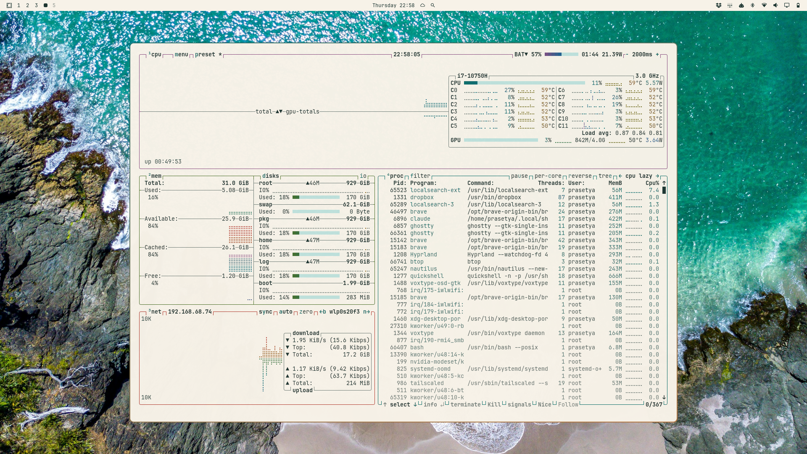

# Day At The Beach

The morning after the sunset. You climb the headland while the sand is still cool, and the tide has gone out far enough to show the rocks. From up here the whole bay opens below you: turquoise shallows fading into deep teal, white foam drawing slow lines along the shore, and pale sand warming under a high sun.

This light theme is that view from above. Sun-bleached sand is the canvas, deep lagoon teal leads the eye, and the rest of the coast fills in the details: wet driftwood, coastal moss, weathered rock and a touch of coral. It is bright without glare and calm enough to work in all day.

A companion to [Sunset At The Beach](https://github.com/mahardhitama/omarchy-sunset-at-the-beach-theme).

## Installation

```bash
omarchy theme install https://github.com/mahardhitama/omarchy-day-at-the-beach-theme.git
```

This clones the theme into `~/.config/omarchy/themes/day-at-the-beach` and applies it. To switch back to it later:

```bash
omarchy theme set day-at-the-beach
```

## Preview




## Palette

The colors come from the wallpapers. Averaged together, the five photos settle on a muted sage teal (`#698e85`), and their dominant clusters are deep teal water, lagoon green, sky blue, sand, foam, dark rock and moss.

- **Background** `#f7f2e8`: sand, the complement of the sea. Warm and slightly off-white, so it does not glare.
- **Foreground** `#1e3632`: dark rock tinted toward the sea, about 11.5:1 against the background.
- **Accent** `#0b6e69`: the deep lagoon, darkened just enough for readable text (5.5:1). The window border runs from this teal into warm driftwood (`#b8763a`), the same pairing of sea and sand.
- **Terminal colors**: each hue is pulled from the coast (coral red, ochre, driftwood, moss, lagoon, deep water, sea urchin, wet sand) and darkened until it reaches at least 4.5:1 contrast (WCAG AA) on both the main and the darker background. In a light theme the bright variants are more saturated rather than lighter, so they stay readable too.

## Wallpapers

- [aerial photography of beach](https://unsplash.com/photos/aerial-photography-of-beach-0kESQGZpLHM) by Rod Long
- [A bird's eye view of a beach and ocean](https://unsplash.com/photos/a-birds-eye-view-of-a-beach-and-ocean--UYj9YdK7Hg) by Josh Fotheringham, Forster, NSW, Australia
- [blue sea waves](https://unsplash.com/photos/blue-sea-waves-zVZNnq4Jpnw) by Gagandeep Singh, Lorne, VIC, Australia
- [an aerial view of a beach with rocks and water](https://unsplash.com/photos/an-aerial-view-of-a-beach-with-rocks-and-water-luJqaDqgNg4) by Look Up Look Down Photography, Mount Maunganui, New Zealand
- [an aerial view of a beach with waves crashing on the shore](https://unsplash.com/photos/an-aerial-view-of-a-beach-with-waves-crashing-on-the-shore-FGluMJCgPNg) by Look Up Look Down Photography, Waihi Beach, New Zealand
